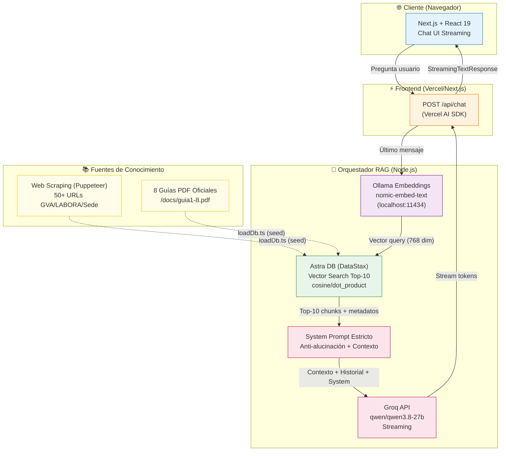

# TramitaBot - Documentación del Chatbot


## PARTE 1: Visión Corporativa (Negocio y Presentación)

### 1. Introducción y Problema

**Problema real que resuelve:**
TramitaBot surge para resolver una necesidad cotidiana y frecuente: **cualquier ciudadano que deba realizar un trámite administrativo en la Comunidad Valenciana se enfrenta a la incertidumbre de qué documentación llevar, qué pasos seguir, qué plazos cumplen o qué oficina visitar**. La información oficial existe, pero está dispersa en múltiples portales (GVA, LABORA, Sede Electrónica, portales universitarios), redactada en lenguaje técnico y difícil de localizar para quien no conoce la administración.

**Propuesta de valor e idea innovadora:**
TramitaBot actúa como un **asistente virtual especializado** que centraliza, comprende y responde en lenguaje natural sobre trámites de la Generalitat Valenciana. Su innovación radica en combinar:
- **Acceso a fuentes oficiales** (web scraping de portales GVA/LABORA + guías PDF oficiales)
- **Búsqueda semántica inteligente** (vector database + embeddings locales)
- **Respuestas contextuales y verificadas** (LLM con prompt engineering estricto anti-alucinación)

El ciudadano pregunta como lo haría a un funcionario: *"¿Qué necesito para empadronarme en Valencia?"* y obtiene una respuesta clara, documentada y accionable en segundos, 24/7, sin esperas ni desplazamientos.

---

### 2. Propuesta de Valor y Funcionalidad

**¿Cómo ayuda TramitaBot?**
| Beneficiario | Valor aportado |
|--------------|----------------|
| **Ciudadanos** | Respuestas inmediatas, precisas y en lenguaje llano sobre requisitos, plazos, oficinas y documentación |
| **Administración** | Descongestión de canales presenciales/telefónicos; reducción de errores por documentación incompleta |
| **Entidades/gestorías** | Consulta rápida de trámites frecuentes para asesorar a clientes |

**Casos de uso principales y ejemplos de interacción:**

| Caso de uso | Pregunta ejemplo del usuario | Respuesta esperada |
|-------------|------------------------------|-------------------|
| **Empadronamiento** | *"¿Cómo me empadrono en Valencia si vivo en alquiler?"* | Pasos: cita previa, contrato/escritura, DNI, formulario; enlace a sede.valencia.es |
| **Becas universitarias** | *"Requisitos para beca Manuela Solís 2024"* | Requisitos académicos, económicos, plazos, documentación; fuente: universitats.gva.es |
| **Desempleo/LABORA** | *"Qué obligaciones tengo como demandante de empleo"* | Renovación DARDE, búsqueda activa, formación; fuente: labora.gva.es |
| **Certificado digital** | *"Qué certificado necesito para tributos autonómicos"* | FNMT, Cl@ve, idCAT; uso en sede.gva.es |
| **Trámite genérico** | *"Qué trámites puedo hacer online en la Generalitat"* | Listado categorizado con enlaces directos a sede electrónica |

**Ejemplo de flujo real:**
```
Usuario: "¿Qué papeles llevo para la tarjeta sanitaria SIP?"
TramitaBot: 
1. Busca en base vectorial (PDFs + web GVA)
2. Recupera chunks relevantes: "DNI/NIE, certificado empadronamiento, formulario..."
3. Genera respuesta estructurada con Markdown:
   - Documentos obligatorios
   - Dónde solicitar (centro de salud / web)
   - Enlace oficial
   - Nota: "Si faltan datos, consulte sede.gva.es"
```

---

## PARTE 2: Memoria y Diseño Técnico

### 1. Portada

| Dato | Información |
|------|-------------|
| **Título del reto** | Repte 1 Chatbot - TramitaBot |
| **Miembros del grupo** | Stevan Jaramillo, Mateu Giner, Hugo Navarro, Raúl Fornés |
| **Fecha** | 17 de noviembre de 2026 |
| **Repositorio** | `github.com/Inventis5/tramitabot` |
| **Despliegue** | Vercel (Next.js 16) |

---

### 2. Introducción Técnica

**Contexto del problema:**
La administración pública valenciana publica información de trámites en múltiples portales web y documentos PDF sin unificadores semánticos. Los ciudadanos necesitan respuestas precisas, pero los buscadores tradicionales fallan ante consultas en lenguaje natural ("qué papeles llevo para...").

**Enfoque de la solución: RAG (Retrieval-Augmented Generation)**
Se implementa una arquitectura **RAG híbrida** que combina:
1. **Ingesta offline**: Scraping de 50+ URLs oficiales + 8 guías PDF → chunking semántico → embeddings (nomic-embed-text via Ollama local) → almacenamiento en Astra DB (vector DB gestionada)
2. **Inferencia online**: Consulta usuario → embedding de la query → búsqueda vectorial Top-K en Astra → construcción de prompt con contexto recuperado → LLM (Groq: qwen3.8-27b) → streaming de respuesta

**Decisiones clave:**
- **Embeddings locales (Ollama)**: Privacidad, coste cero, latencia controlada
- **Groq como LLM**: Inferencia ultrarrápida (~100 tokens/s), modelo open-source potente
- **Astra DB (DataStax)**: Vector DB serverless, escalable, compatible con LangChain
- **Next.js App Router + Vercel AI SDK**: Streaming nativo, edge-ready, DX óptima

---

### 3. Disseny de la Solució (Diseño de la Solución)

#### 3.1 Descripción de la Arquitectura



**Flujo detallado paso a paso:**

1. **Usuario** escribe pregunta en la interfaz chat (`app/page.tsx` → `useChat` hook de Vercel AI SDK)
2. **Frontend** envía `POST /api/chat` con historial de mensajes (`messages[]`)
3. **API Route** (`app/api/chat/route.ts`):
   - Extrae `latestMessage` (último mensaje del usuario)
   - Genera **embedding** con Ollama (`nomic-embed-text`, 768 dimensiones)
   - Ejecuta **búsqueda vectorial** en Astra DB (`collection.find({$vector}, limit: 10)`)
   - Recupera `docContent` = chunks de texto + metadatos `source` (URL o PDF)
   - Construye **system prompt** inyectando contexto recuperado (`START CONTEXT ... END CONTEXT`)
   - Llama a **Groq LLM** (`qwen/qwen3.8-27b`) con `stream: true`
   - Retorna `StreamingTextResponse` al cliente
4. **Frontend** renderiza tokens en tiempo real (`Bubble` + `LoadingBubble`)

#### 3.2 Llenguatges i Tecnologies Utilitzades

| Capa | Tecnología | Versión | Propósito |
|------|------------|---------|-----------|
| **Framework Web** | Next.js | 16.4.5 | App Router, Server Components, API Routes, Edge-ready |
| **Runtime** | React | 19.3.0 | UI reactiva, hooks, streaming |
| **Lenguaje** | TypeScript | 5.x | Tipado estricto, DX |
| **Orquestación RAG** | LangChain.js | 1.6.2 (`@langchain/core`, `@langchain/community`, `@langchain/ollama`, `@langchain/textsplitters`) | Carga docs, splitting, embeddings, integración vector DB |
| **Vector Database** | Astra DB (DataStax) | `@datastax/astra-db-ts` 2.3.0 | Almacenamiento vectorial serverless, búsqueda semántica |
| **Embeddings** | Ollama (local) | `nomic-embed-text` | Embeddings 768-dim, privacidad, coste cero |
| **LLM Generativo** | Groq Cloud | `qwen/qwen3.8-27b` | Inferencia ultrarrápida, streaming, contexto 8k+ |
| **Web Scraping** | Puppeteer + LangChain | `@langchain/community` | Extracción texto de 50+ URLs oficiales (GVA, LABORA, Sede) |
| **Carga PDF** | PDFLoader (LangChain) | `@langchain/community` | Parsing 8 guías oficiales en `/docs/` |
| **Text Splitting** | RecursiveCharacterTextSplitter | `@langchain/textsplitters` | Chunking 512 chars / 100 overlap |
| **Streaming UI** | Vercel AI SDK | `ai` 3.4.33 | `useChat`, `StreamingTextResponse`, `OpenAIStream` adapter |
| **Estilos** | CSS Modules / Global CSS | — | `global.css`, clases `.bubble`, `.loader`, `.prompt-suggestion-*` |
| **Despliegue** | Vercel | — | CI/CD automático, edge functions, env vars |
| **Dev Tools** | ESLint 9, ts-node | — | Linting, scripts TypeScript directos |

**Variables de entorno requeridas (`.env`):**
```bash
ASTRA_DB_KEYSPACE=           # Keyspace/nombre BD en Astra
ASTRA_DB_COLLECTION=         # Colección vectorial (ej. tramitabot)
ASTRA_DB_API_ENDPOINT=       # Endpoint API Astra (ej. https://xxx.apps.astra.datastax.com)
ASTRA_DB_APPLICATION_TOKEN=  # Token aplicación Astra (AstraCS:...)
GROQ_API_KEY=                # API Key Groq Cloud (gsk_...)
# Opcional para embeddings locales:
# OLLAMA_BASE_URL=http://localhost:11434
```

---

### 4. Resultats (Resultados)

#### 4.1 Análisis de Funcionamiento (Comportamiento Esperado)

| Métrica / Aspecto | Resultado Esperado | Validación |
|-------------------|-------------------|------------|
| **Latencia primera token (TTFT)** | < 2 s (Groq streaming) | Groq ~100 tok/s + Vercel edge |
| **Latencia embedding (Ollama local)** | ~200-500 ms | nomic-embed-text en CPU/GPU local |
| **Búsqueda vectorial (Astra)** | < 300 ms (Top-10) | Serverless, región cercana |
| **Precisión recuperación (RAG)** | Alta para trámites GVA/LABORA | Chunking 512 + overlap 100 + 50 fuentes |
| **Cobertura temática** | Empleo, becas, empadronamiento, certificados, formación, ayudas | 50 URLs + 8 PDFs oficiales |
| **Idiomas** | Español + Valenciano | System prompt bilingüe |
| **Formato respuesta** | Markdown (listas, negritas, enlaces) | Instrucción explícita en prompt |
| **Anti-alucinación** | "No inventes..." + fallback a sede.gva.es | System prompt estricto |

#### 4.2 Comportamiento ante Situaciones Clave

| Situación | Pregunta Ejemplo | Comportamiento TramitaBot |
|-----------|------------------|---------------------------|
| **Trámite cubierto en fuentes** | *"Requisitos beca Manuela Solís"* | Respuesta estructurada con requisitos, plazos, docs, enlace fuente |
| **Trámite parcial (solo web)** | *"Cómo inscribirme en LABORA"* | Info de web scrapada (labora.gva.es) + enlace cita previa |
| **Trámite solo en PDF** | *"Guía empadronamiento Valencia"* | Contenido extraído de `guiaX.pdf` + referencia archivo |
| **Fuera de ámbito (no hay contexto)** | *"Cómo renovar pasaporte"* | Respuesta: "No tengo info en mis fuentes. Consulte sede.gva.es o Policía Nacional" |
| **Pregunta ambigua** | *"Quiero una ayuda"* | Pregunta clarificadora: "¿Ayuda al desempleo, formación, vivienda...?" |
| **Idioma valenciano** | *"Com m'empadrino a València?"* | Respuesta en valenciano, misma calidad |
| **Consulta multi-paso** | *"Tarjeta sanitaria y luego empadronamiento"* | Responde secuencial o pide separar consultas |
| **Fuente oficial citada** | Cualquier respuesta | Incluye `source` (URL o PDF) implícito en contexto |

#### 4.3 Métricas de Calidad (Cualitativas)

- **Veracidad**: Respuestas basadas exclusivamente en contexto recuperado (RAG). Zero-shot hallucination mitigado por system prompt.
- **Utilidad**: Formato accionable (checklists, pasos numerados, enlaces directos).
- **Experiencia**: Streaming token-a-token → percepción de velocidad inmediata.
- **Robustez**: Try/catch en DB + LLM → fallback graceful (respuesta vacía → mensaje genérico).

---

### 5. Conclusió (Conclusión)

#### 5.1 Reflexión Crítica del Desarrollo

**Lo que ha funcionado bien:**
- **Arquitectura RAG limpia**: Separación clara ingesta/inferencia, stack moderno y mantenible.
- **Elección de Groq + Ollama**: Coste operativo near-zero, latencia excelente, soberanía de embeddings.
- **Fuentes oficiales priorizadas**: Scraping + PDFs de GVA/LABORA/Sede → confianza alta en respuestas.
- **Prompt engineering estricto**: Anti-alucinación, bilingüe, formato Markdown, fallback explícito.
- **DX con Vercel AI SDK**: Streaming nativo, hooks React sencillos, deployment zero-config.

**Retos y limitaciones identificadas:**
| Área | Limitación | Impacto |
|------|------------|---------|
| **Actualización datos** | Seed manual (`npm run seed`); no hay pipeline automático | Fuentes pueden desactualizarse (convocatorias anuales, cambios normativos) |
| **Cobertura temática** | 50 URLs + 8 PDFs → gaps en trámites menores/nuevos | Usuario puede no encontrar su trámite específico |
| **Embeddings locales** | Requiere Ollama corriendo (localhost:11434) | Complejidad en despliegue serverless (Vercel no soporta sidecars) |
| **Contexto limitado** | Top-10 chunks × 512 chars ≈ 5k tokens contexto | Trámites complejos pueden truncar info relevante |
| **Evaluación automática** | Ausencia de tests de regresión / golden set | Dificultad para medir calidad tras cambios de prompt/modelo |

#### 5.2 Mejoras Futuras y Escalabilidad

| Prioridad | Mejora | Descripción Técnica |
|-----------|--------|---------------------|
| **Alta** | **Pipeline CI/CD de ingesta** | GitHub Action semanal: scrape → embed → upsert Astra (detectar diffs) |
| **Alta** | **Embeddings en producción** | Migrar Ollama → modelo gestionado (Voyage AI, Cohere, o embedding API Groq) para serverless |
| **Media** | **Evaluación automática (RAGAS)** | Golden set 50 Q&A → métricas faithfulness, answer_relevancy, context_precision |
| **Media** | **Reranking semántico** | Añadir Cohere Rerank / Jina Reranker entre retrieval y generation (mejora precision@k) |
| **Media** | **Caché de consultas frecuentes** | Redis/Upstash para preguntas repetidas (empadronamiento, becas, tarjeta SIP) |
| **Baja** | **Multi-agente / Tool use** | Agente que llame APIs oficiales (cita previa, estado expediente) vía function calling |
| **Baja** | **Analytics y feedback** | Logging estructurado (pregunta, chunks usados, respuesta, 👍/👎 usuario) → fine-tuning futuro |
| **Baja** | **Internacionalización completa** | i18n Next.js + detección idioma automática + fuentes en inglés/francés para residentes UE |

**Escalabilidad técnica:**
- **Astra DB**: Escala automática (serverless), soporta millones de vectores.
- **Groq**: Rate limits generosos, escalado horizontal transparente.
- **Vercel**: Edge Functions + ISR para UI estática; API Routes en Node.js runtime.
- **Coste estimado**: ~$0/mes (Groq free tier + Astra free tier + Vercel hobby + Ollama local). Producción: ~$20-50/mes.

---

### 6. Referències (Referencias)

**Documentación Oficial y Recursos Clave:**

| Tecnología | Enlace | Uso en Proyecto |
|------------|--------|-----------------|
| **Next.js 16 (App Router)** | https://nextjs.org/docs | Framework principal, API Routes, Streaming |
| **Vercel AI SDK** | https://sdk.vercel.ai/docs | `useChat`, `StreamingTextResponse`, `OpenAIStream` |
| **LangChain.js** | https://js.langchain.com/docs/ | Carga docs, splitting, embeddings, vector store |
| **LangChain - Astra DB Integration** | https://js.langchain.com/docs/integrations/vectorstores/astradb | Vector store gestionado |
| **Astra DB (DataStax) Docs** | https://docs.datastax.com/en/astra/ | Vector DB serverless, colecciones, búsqueda |
| **Groq Cloud API** | https://console.groq.com/docs | LLM qwen/qwen3.8-27b, streaming, rate limits |
| **Ollama** | https://ollama.com/ | Embeddings locales nomic-embed-text |
| **nomic-embed-text** | https://huggingface.co/nomic-ai/nomic-embed-text-v1.5 | Modelo embedding 768-dim, licencia Apache 2.0 |
| **Puppeteer Web Loader** | https://js.langchain.com/docs/integrations/document_loaders/puppeteer | Scraping JS-heavy sites (GVA, LABORA) |
| **PDFLoader (LangChain)** | https://js.langchain.com/docs/integrations/document_loaders/pdf | Parsing guías oficiales PDF |
| **RecursiveCharacterTextSplitter** | https://js.langchain.com/docs/concepts/text_splitters | Chunking semántico 512/100 |
| **qwen3.8-27b (Groq)** | https://huggingface.co/Qwen/Qwen2.5-Coder-32B-Instruct | Modelo generativo open-source, 8k contexto |

**Fuentes de Datos Oficiales (Generalitat Valenciana):**
- Portal LABORA: `https://labora.gva.es` (empleo, formación, demandantes)
- Sede Electrónica GVA: `https://sede.gva.es` (trámites, identificadores, certificados)
- Universitats GVA: `https://universitats.gva.es` (becas Manuela Solís, finalización estudios)
- Portal Becas GVA: `https://www.gva.es/es/inicio/procedimientos` (convocatorias oficiales)
- Ayuntamiento Valencia: `https://sede.valencia.es` (empadronamiento, padrón)
- Registro Civil GVA: `https://registrocivil.gva.es` (vecindad civil)

---

### 7. Codi Font i Configuracions (Código Fuente y Configuraciones)

#### 7.1 Estructura de Ficheros Relevante

```
nextjs-tramitabot/
├── app/
│   ├── api/chat/route.ts          # 🔥 Endpoint RAG principal (POST)
│   ├── page.tsx                   # 🔥 UI Chat (useChat, streaming)
│   ├── components/
│   │   ├── Bubble.tsx             # Burbuja mensaje (user/assistant)
│   │   ├── LoadingBubble.tsx      # Animación loading 3 dots
│   │   ├── PromptSuggestionButton.tsx
│   │   └── PromptSuggestionRow.tsx # 4 sugerencias iniciales
│   ├── assets/
│   │   ├── tramitabot.webp        # Logo
│   │   └── background.png
│   ├── layout.tsx                 # Root layout + fuentes Geist
│   └── global.css                 # Estilos globales (burbujas, input, loader)
├── scripts/
│   └── loadDb.ts                  # 🔥 Ingesta datos (scrape + PDF → Astra)
├── docs/
│   ├── guia1.pdf ... guia8.pdf    # 8 guías oficiales fuente
├── .env                           # Variables entorno (no commitear)
├── package.json                   # Dependencias + scripts
├── next.config.ts                 # Next.js config (reactCompiler: true)
├── tsconfig.json                  # TypeScript strict mode
└── README.md                      # Esta documentación
```

#### 7.2 Fragmentos Clave de Código

**A. `app/api/chat/route.ts` — Núcleo RAG (Orquestador)**

```typescript
import { Groq } from 'groq-sdk';
import { DataAPIClient } from '@datastax/astra-db-ts';
import { OllamaEmbeddings } from '@langchain/ollama';
import { OpenAIStream, StreamingTextResponse } from 'ai';

const {
  ASTRA_DB_KEYSPACE,
  ASTRA_DB_COLLECTION,
  ASTRA_DB_API_ENDPOINT,
  ASTRA_DB_APPLICATION_TOKEN,
  GROQ_API_KEY
} = process.env;

const groq = new Groq({ apiKey: GROQ_API_KEY });
const client = new DataAPIClient(ASTRA_DB_APPLICATION_TOKEN);
const db = client.db(ASTRA_DB_API_ENDPOINT, { keyspace: ASTRA_DB_KEYSPACE });

export async function POST(req: Request) {
  try {
    const { messages } = await req.json();
    const latestMessage = messages[messages.length - 1]?.content;

    // 1. Embedding de la query (Ollama local)
    const embeddings = new OllamaEmbeddings({
      model: 'nomic-embed-text',
      baseUrl: 'http://localhost:11434'
    });
    const vector = await embeddings.embedQuery(latestMessage);

    // 2. Búsqueda vectorial Top-10 en Astra DB
    let docContent = '';
    try {
      const collection = await db.collection(ASTRA_DB_COLLECTION!);
      const cursor = collection.find(null, {
        sort: { $vector: vector },
        limit: 10
      });
      const documents = await cursor.toArray();
      const docsMap = documents?.map(doc => doc.text || doc.content);
      docContent = JSON.stringify(docsMap);
    } catch (err) {
      console.log('Error querying db...');
      docContent = '';
    }

    // 3. System Prompt estricto con contexto inyectado
    const systemPrompt = {
      role: 'system',
      content: `Eres TramitaBot, un asistente virtual especializado en trámites administrativos de la Generalitat Valenciana.
Utiliza el contexto proporcionado, procedente de documentos PDF y fuentes oficiales, para responder a las consultas de los ciudadanos.
Responde de forma clara, sencilla y concisa, utilizando únicamente la información disponible en el contexto.
Si la información necesaria no aparece en el contexto, indícalo y recomienda consultar la sede electrónica oficial de la Generalitat Valenciana.
No inventes requisitos, documentos, plazos, importes ni procedimientos.
Tu función es orientar e informar sobre los trámites administrativos, no realizar solicitudes ni gestionar procedimientos en nombre del usuario.
Responde en español o valenciano según el idioma utilizado por el usuario.
Utiliza Markdown cuando sea necesario y evita respuestas demasiado largas.
------------------
START CONTEXT
${docContent}
END CONTEXT
------------------
QUESTION: ${latestMessage}`
    };

    // 4. LLM Groq con streaming
    const response = await groq.chat.completions.create({
      model: 'qwen/qwen3.8-27b',
      stream: true,
      messages: [systemPrompt, ...messages]
    });

    const stream = OpenAIStream(response as any);
    return new StreamingTextResponse(stream);

  } catch (err) {
    throw err;
  }
}
```

**B. `scripts/loadDb.ts` — Ingesta de Datos (Seed Offline)**

```typescript
import { DataAPIClient } from '@datastax/astra-db-ts';
import { PuppeteerWebBaseLoader } from '@langchain/community/document_loaders/web/puppeteer';
import { OllamaEmbeddings } from '@langchain/ollama';
import { RecursiveCharacterTextSplitter } from '@langchain/textsplitters';
import { PDFLoader } from '@langchain/community/document_loaders/fs/pdf';
import 'dotenv/config';
import path from 'path';

// 50+ URLs oficiales GVA/LABORA/Sede
const tramitabotData = [
  // LABORA (empleo, formación, demandantes)
  'https://labora.gva.es/es/ciutadania/busque-ocupacio/com-inscriuret/inscrpicio',
  'https://labora.gva.es/es/ciutadania/busque-ocupacio/obligacions-dels-demandants-d-ocupacio',
  'https://labora.gva.es/es/autoservef',
  // Becas universitarias y no universitarias
  'https://www.gva.es/es/inicio/procedimientos?id_proc=G95885',
  'https://universitats.gva.es/es/manuela-solis/convocatoria',
  'https://www.gva.es/es/inicio/procedimientos?id_proc=E242',
  // Empadronamiento / identificación
  'https://sede.gva.es/es/detall-tramit?id_proc=21561',
  'https://sede.valencia.es/sede/registro/procedimiento/pa.ce.10?lang=1',
  // ... más URLs
];

// 8 PDFs guías oficiales en /docs/
const pdfFiles = [
  path.resolve('./docs/guia1.pdf'), ..., path.resolve('./docs/guia8.pdf')
];

const splitter = new RecursiveCharacterTextSplitter({
  chunkSize: 512,
  chunkOverlap: 100
});

const embeddings = new OllamaEmbeddings({
  model: 'nomic-embed-text',
  baseUrl: 'http://localhost:11434'
});

// Crear colección vectorial (768 dim, dot_product)
const createCollection = async (similarityMetric = 'dot_product') => {
  await db.createCollection(ASTRA_DB_COLLECTION!, {
    vector: { dimension: 768, metric: similarityMetric }
  });
};

// Scraping con Puppeteer (espera networkidle2, 60s timeout)
const scrapePage = async (url: string) => {
  const loader = new PuppeteerWebBaseLoader(url, {
    launchOptions: { headless: true, args: ['--no-sandbox', '--disable-setuid-sandbox'] },
    gotoOptions: { waitUntil: 'networkidle2', timeout: 60000 },
    evaluate: async (page, browser) => {
      const result = await page.evaluate(() => document.body.innerText);
      await browser.close();
      return result;
    }
  });
  return (await loader.scrape())?.replace(/\s+/g, ' ').trim() || '';
};

// Pipeline completo: URLs → chunks → embeddings → Astra
const loadSampleData = async () => {
  const collection = await db.collection(ASTRA_DB_COLLECTION);

  // 1. Web scraping
  for await (const url of tramitabotData) {
    const content = await scrapePage(url);
    if (!content) continue;
    const chunks = await splitter.splitText(content);
    for await (const chunk of chunks) {
      if (chunk.trim().length < 50) continue;
      const vector = await embeddings.embedQuery(chunk);
      await collection.insertOne({ $vector: vector, text: chunk, source: url });
    }
    await new Promise(r => setTimeout(r, 2000)); // Rate limit cortesía
  }

  // 2. PDFs
  for (const pdfPath of pdfFiles) {
    const loader = new PDFLoader(pdfPath);
    const docs = await loader.load();
    const content = docs.map(d => d.pageContent).join('\n');
    const chunks = await splitter.splitText(content);
    for (const chunk of chunks) {
      if (chunk.trim().length < 50) continue;
      const vector = await embeddings.embedQuery(chunk);
      await collection.insertOne({ $vector: vector, text: chunk, source: pdfPath });
    }
  }
};

createCollection().then(() => loadSampleData().then(() => {
  console.log('Carga de datos completada.');
  process.exit(0);
}));
```

**C. `app/page.tsx` — Interfaz de Chat (Streaming UI)**

```tsx
'use client';
import Image from 'next/image';
import tramitabot from './assets/tramitabot.webp';
import { useChat } from 'ai/react';
import { useState } from 'react';
import Bubble from './components/Bubble';
import LoadingBubble from './components/LoadingBubble';
import PromptSuggestionRow from './components/PromptSuggestionRow';

const Home = () => {
  const { messages, input, handleInputChange, handleSubmit, append, isLoading } = useChat();
  const noMessage = !messages || messages.length === 0;

  const handlePrompt = (promptText: string) => {
    const msg = { id: crypto.randomUUID(), content: promptText, role: 'user' as const };
    append(msg);
  };

  return (
    <main>
      <Image src={tramitabot} width={250} alt="TramitaBot Logo" />
      <section className={noMessage ? '' : 'populated'}>
        {noMessage ? (
          <>
            <p className="starter-text">
              Bienvenido a TramitaBot aquí podrás consultar tus dudas sobre algunos trámites en la Comunidad Valenciana
            </p>
            <br />
            <PromptSuggestionRow onPromptClick={handlePrompt} />
          </>
        ) : (
          <>
            {messages.map((message, index) => (
              <Bubble key={`message-${index}`} message={message} />
            ))}
            {isLoading && <LoadingBubble />}
          </>
        )}
      </section>
      <form onSubmit={handleSubmit}>
        <input
          className="question-box"
          onChange={handleInputChange}
          value={input}
          placeholder="preguntame algo..."
        />
        <input type="submit" value="enviar" />
      </form>
    </main>
  );
};
export default Home;
```

**D. Componentes UI Mínimos**

```tsx
// Bubble.tsx
const Bubble = ({ message }) => {
  const { content, role } = message;
  return <div className={`${role} bubble`}>{content}</div>;
};

// LoadingBubble.tsx
const LoadingBubble = () => (
  <div className="loader">
    <div></div><div></div><div></div>
  </div>
);

// PromptSuggestionRow.tsx
const prompts = [
  '¿Cómo puedo empadronarme en Valencia?',
  '¿Qué trámites puedo hacer en la Generalitat Valenciana?',
  '¿Cómo solicito la tarjeta sanitaria?',
  '¿Qué certificado digital necesito para tributos?'
];
const PromptSuggestionRow = ({ onPromptClick }) => (
  <div className="prompt-suggestion-row">
    {prompts.map((prompt, i) => (
      <PromptSuggestionButton key={i} text={prompt} onClick={() => onPromptClick(prompt)} />
    ))}
  </div>
);
```

**E. Configuración `package.json` (Scripts y Dependencias)**

```json
{
  "name": "nextjs-tramitabot",
  "version": "0.1.0",
  "private": true,
  "scripts": {
    "dev": "next dev",
    "build": "next build",
    "start": "next start",
    "seed": "ts-node ./scripts/loadDb.ts",
    "lint": "eslint"
  },
  "dependencies": {
    "@datastax/astra-db-ts": "^2.3.0",
    "@langchain/community": "^1.1.29",
    "@langchain/core": "^1.3.5",
    "@langchain/ollama": "^1.3.0",
    "@langchain/textsplitters": "^1.0.0",
    "ai": "^3.4.33",
    "dotenv": "^18.0.9",
    "groq-sdk": "^1.6.0",
    "langchain": "^1.6.2",
    "next": "16.4.5",
    "react": "19.3.0",
    "react-dom": "19.3.0"
  },
  "devDependencies": {
    "@types/node": "^20.19.43",
    "@types/react": "^19",
    "@types/react-dom": "^19",
    "babel-plugin-react-compiler": "1.0.0",
    "eslint": "^9",
    "eslint-config-next": "16.4.5",
    "ts-node": "^10.9.2",
    "typescript": "^5"
  }
}
```

**F. Variables de Entorno (`.env.example`)**

```bash
# Astra DB (DataStax) - Vector Database
ASTRA_DB_KEYSPACE=tu_keyspace
ASTRA_DB_COLLECTION=tramitabot
ASTRA_DB_API_ENDPOINT=https://tu-db-xxx.apps.astra.datastax.com
ASTRA_DB_APPLICATION_TOKEN=AstraCS:tu_token_aqui

# Groq Cloud - LLM Generativo
GROQ_API_KEY=gsk_tu_api_key_aqui

# Opcional: Ollama Embeddings (por defecto localhost:11434)
# OLLAMA_BASE_URL=http://localhost:11434
```

**G. `next.config.ts`**

```typescript
import type { NextConfig } from 'next';

const nextConfig: NextConfig = {
  reactCompiler: true,      // React Compiler (React 19)
  reactStrictMode: true
};

export default nextConfig;
```

---

## Despliegue Rápido (Checklist)

```bash
# 1. Clonar e instalar
git clone <repo> && cd nextjs-tramitabot
npm install

# 2. Configurar .env (ver .env.example)
cp .env.example .env && edit .env

# 3. Levantar Ollama local (embeddings)
ollama serve &
ollama pull nomic-embed-text

# 4. Cargar base de conocimiento (una vez / periódicamente)
npm run seed

# 5. Desarrollo
npm run dev          # http://localhost:3000

# 6. Producción (Vercel)
vercel --prod        # Variables de entorno en dashboard Vercel
```

---

**TramitaBot** — *Haciendo accesible la administración valenciana, una pregunta a la vez.*

*Documentación generada automáticamente para el Repte 1 Chatbot — Noviembre 2026*